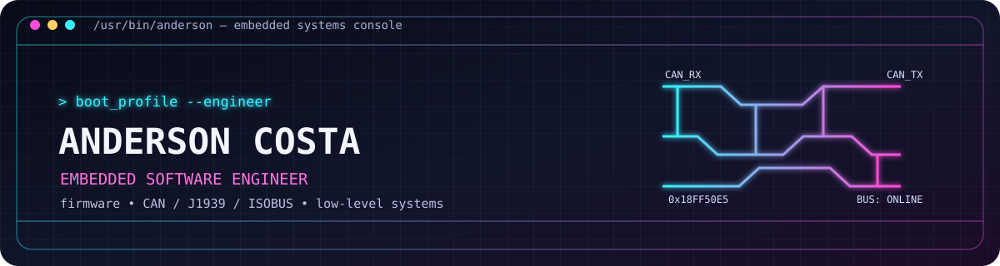

<p align="center">
  
</p>

<p align="center">
  <a href="https://arcostasi.github.io">WEBSITE</a> &nbsp;|&nbsp;
  <a href="https://linkedin.com/in/arcostasi">LINKEDIN</a> &nbsp;|&nbsp;
  <a href="https://github.com/arcostasi">GITHUB</a>
</p>

## `arcostasi@ar2labs:~# whoami`

**Anderson Costa** · Embedded Software Engineer

I work close to the hardware: firmware, real-time behavior, and the communication layers that keep agricultural and industrial machines talking. My day-to-day interests live somewhere between registers, buses, and the code that makes them behave.

```text
$ cat /proc/anderson/focus
firmware       C / C++ · architecture · optimization
buses          CAN · CANopen · SAE J1939 · ISOBUS (ISO 11783) · LIN
platforms      STM32 · ESP32 · XMC · Microchip · Embedded Linux
runtime        FreeRTOS · real-time embedded applications
bench          oscilloscopes · logic analyzers · CAN analyzers
```

## `arcostasi@ar2labs:~# ls ./workbench`

- [**ESP32 Javatari Embedded**](https://github.com/arcostasi/esp32-javatari-embedded) — an ESP32-powered Atari 2600 emulator built into an Atari CX40 joystick.
- [**AVR8js Electron Playground**](https://github.com/arcostasi/avr8js-electron-playground) — an Electron playground built with AVR8js and Wokwi Elements.
- [**My Wokwi Projects**](https://github.com/arcostasi/my-wokwi-projects) — Arduino experiments prototyped in the Wokwi simulator.

## `arcostasi@ar2labs:~# dmesg --follow`

Currently interested in reliable protocol stacks, ECU software, hardware/software integration, signal diagnostics, and performance-focused C/C++.

**Toolchain:** Git · CMake · Docker · CI/CD · Python scripting · Vector CANoe · PCAN-Explorer

## `arcostasi@ar2labs:~# ./connect.sh`

Open to interesting embedded, firmware, and communication-system projects.

[](https://arcostasi.github.io)
[](https://linkedin.com/in/arcostasi)
[](https://github.com/arcostasi)
