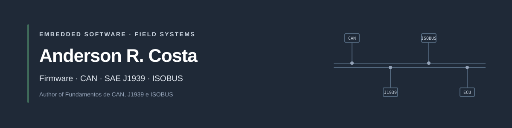

  

  <a href="https://arcostasi.github.io">Portfolio</a> ·
  <a href="https://dobitaocampo.com.br/">Book</a> ·
  <a href="https://linkedin.com/in/arcostasi">LinkedIn</a>

# Anderson Costa

Embedded software developer at AR2 Labs, connecting firmware, electronics, and communication networks to build solutions for agricultural and industrial automation. Working in software since 1997, with a focus on systems that bridge hardware, real-time behavior, and operator-facing applications.

I am the author of [*Fundamentos de CAN, J1939 e ISOBUS*](https://dobitaocampo.com.br/), a practical guide to the networks that connect tractors and implements—from the physical layer to diagnostics.

## Focus areas

- **Firmware and embedded systems:** C/C++ for PIC, AVR, STM32, ESP32, and RP2040; FreeRTOS; Embedded Linux with Rust and Slint.
- **Vehicle networks and agricultural automation:** CAN, CANopen, SAE J1939, ISOBUS (ISO 11783), Virtual Terminal (VT), Task Controller (TC), and LIN.
- **Connected applications:** Wi-Fi device integration; web and supervisory systems with JavaScript, TypeScript, Node.js, and PHP; Android with Kotlin; and cross-platform apps with Flutter and Dart.
- **Lab and toolchain:** oscilloscopes, logic analyzers, Vector CANoe, PCAN-Explorer, Git, and CMake.

## Selected projects

- [**TorqueBus Studio**](https://github.com/ar2labs/torquebus) — an open workbench for CAN capture, DBC decoding, diagnostics, simulation, and dashboards.
- [**AVR8js Electron Playground**](https://github.com/arcostasi/avr8js-electron-playground) — an offline Arduino simulator with a visual circuit editor, peripherals, and diagnostics.
- [**6502 Laboratory Simulator**](https://github.com/arcostasi/6502-labsim) — an interactive MOS 6502 computer with an assembler, live bus views, and a test runner.
- [**Harbour Rust**](https://github.com/arcostasi/harbour-rust) — a Rust compiler project for CA-Clipper and Harbour compatibility, with a C backend, tests, and continuous integration.

## Technical book

[*Fundamentos de CAN, J1939 e ISOBUS*](https://dobitaocampo.com.br/) covers CAN, SAE J1939, and ISO 11783 in 22 chapters, with 112 exercises and four diagnostic case studies. The first edition has 217 pages. [Read a free sample](https://dobitaocampo.com.br/#amostra).

## Contact

[Portfolio](https://arcostasi.github.io) · [LinkedIn](https://linkedin.com/in/arcostasi) · [GitHub](https://github.com/arcostasi)
